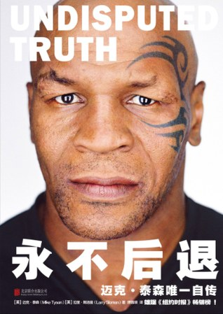

# 《永不后退：迈克·泰森唯一自传》（Undisputed Truth）🥊

地球上最凶悍的男人，其实是一个从未学会爱自己的、吓坏了的孩子——这本自传，就是他当着全世界的面想明白这件事的过程。

## 内容简介 📖

这是泰森用自己的声音讲述的一生：粗口连篇、自嘲、坦白到近乎残忍，却出人意料地充满哲理。全书的主线是老教练库斯·达马托（Cus D'Amato）——他收留了这个布鲁克林贫民区的穷小子，从心智开始重塑他。库斯的心理学贯穿始终：英雄和懦夫感受到的恐惧一模一样，区别只在纪律；你的头脑不是你的朋友，你必须驾驭它。库斯给泰森灌输的不是钱，而是"不朽"——让名字被传颂到时间尽头。20岁，泰森成为史上最年轻的重量级拳王；可库斯在前一年已去世。之后的故事，就是一件武器在失去铸剑人之后的命运。

💥 泰森坦言，名人地位给他带来了混乱的生活——女人、可卡因、从没开过的车、从没住过的房子。他把自己劈成两个人：对家人而言的Mike，和那个只负责赚钱的怪物"Tyson"。1992年他因强奸罪服刑三年，却把监狱称为"因祸得福"——那是他人生第一次能静下来。然后是漫长的坠落：爆冷负于道格拉斯、输给霍利菲尔德、挣了三亿美元却破产、骗药检、一次次复吸。再然后，是缓慢的爬起 🌅：心理治疗、戒瘾互助会，以及迟来的领悟——他用性换取亲密关系，其实一辈子都在寻找母亲从未给过的爱。妻子琪琪"把我从阴沟里挖了出来"；2009年小女儿Exodus意外离世，成了他坚持康复的理由——一天一天地来。

## 我的评价 💭

2002年泰森对阵伦诺克斯·刘易斯那场比赛，我小时候看过——那已是坠落后的泰森，第八回合被击倒。这本书补全了我只看过中段的故事，我读得非常过瘾。

先打个预防针：这可能是史上最"生猛"的自传——全书大约爆了600个"fuck"、412个"shit"、125个"nigga"。🤬 这不是编辑偷懒，这就是泰森原汁原味的声音，也正是这本书让人觉得"真"的原因。

最打动我的：这是一个跌入谷底再站起来的故事。库斯说，失败唯一的错误是没从中学到东西——泰森用一生印证了这句话。他说道格拉斯那一战是自己最好的一战，因为他挨了打，然后触底反弹。破产之后，他反而第一次觉得富有：没有手表、没有手机、没人追着他跑。"兄弟，这才叫富有。"🙌

但要带着怀疑去读。对强奸罪，泰森始终坚称无罪——法庭判决摆在那里。书里川流不息的女人，他讲得诚实；两段婚姻都没扛过他描述的那种生活。全书最可信的悔意反而最简单："如今能守着一个女人，我太幸福了。"❤️

他并不乞求原谅——"我肮脏而卑劣，但我现在想弥补。"你可以不信他真的变了，但这份努力本身，就是故事。

## 摘录 ✍️

> "英雄和懦夫感受到的恐惧一模一样，但你必须有纪律去做英雄做的事。"

> "输不要紧，要紧的是输了之后你做什么。"

> "人生不是关于积累，人生是关于失去。"

📚 我在书中的全部划线摘录：[《永不后退》笔记](/notes/undisputed-truth)
