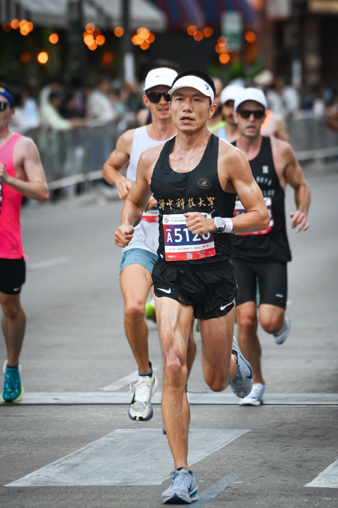
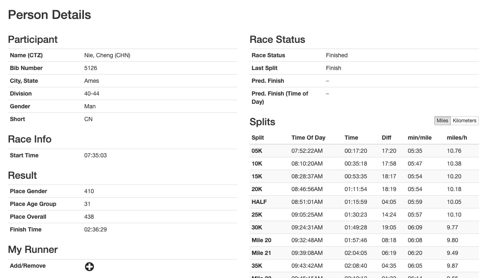
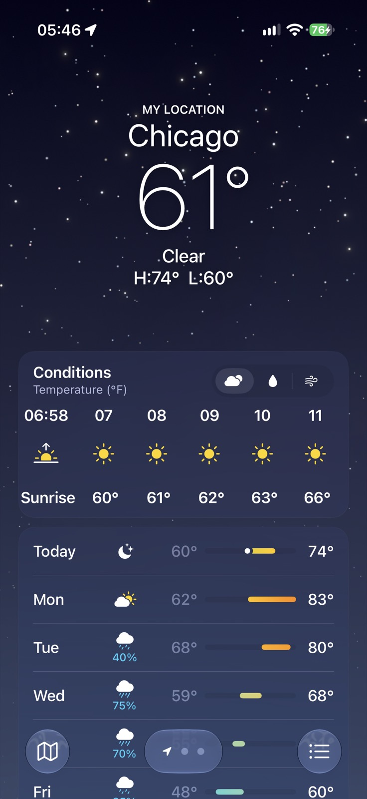
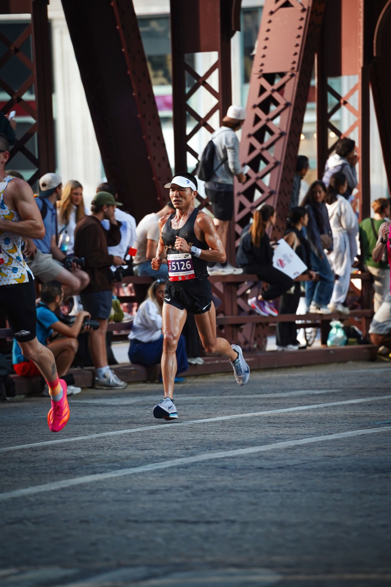
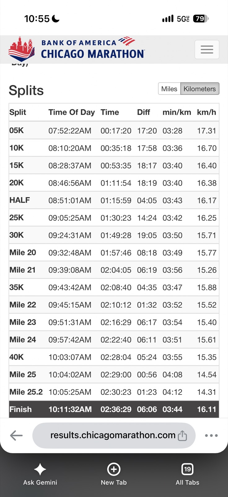
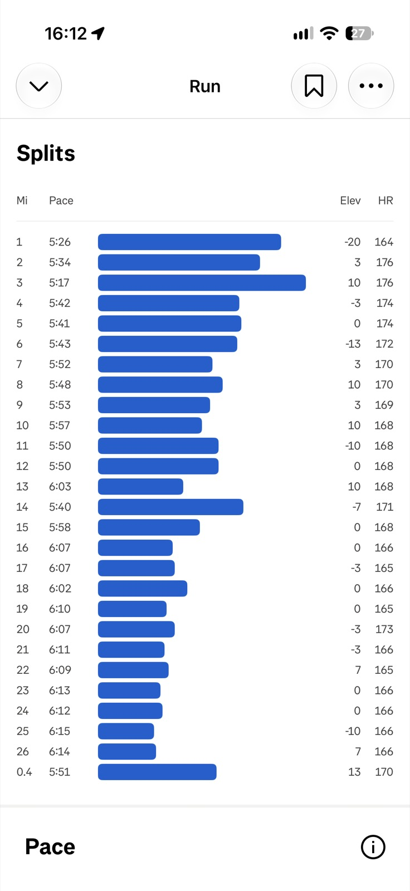
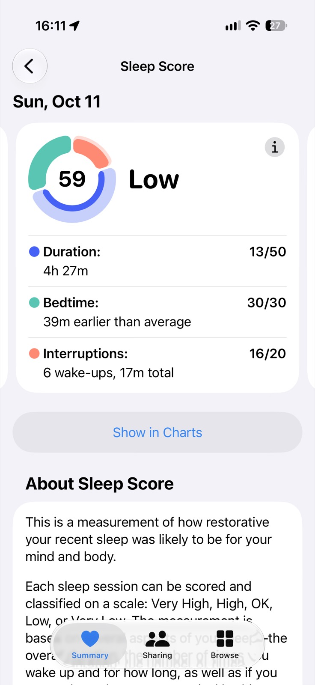
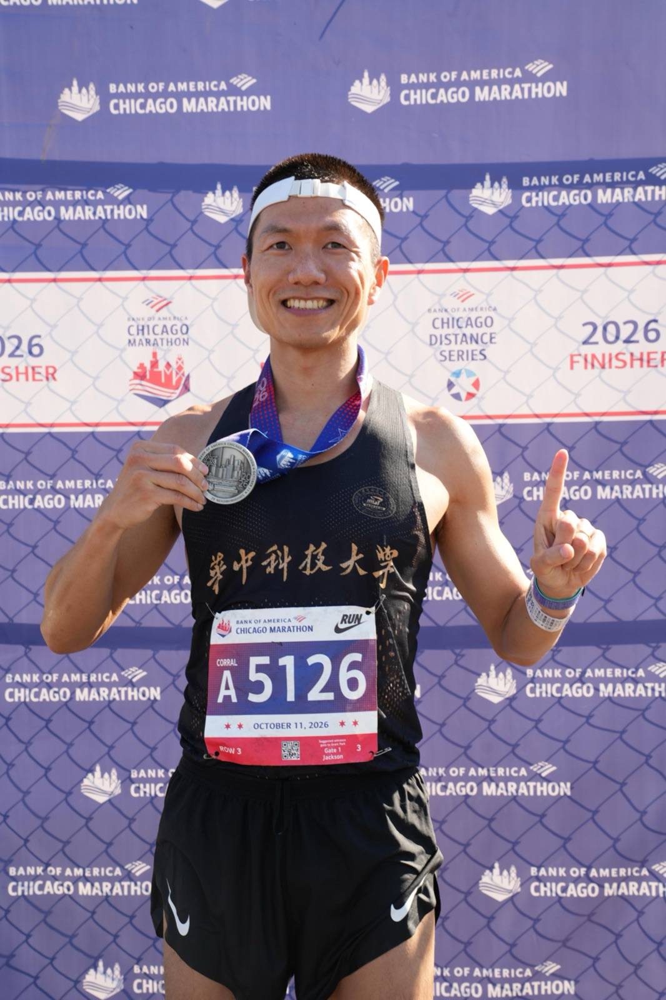

# 2026 芝加哥马拉松 🏅

2026年10月11日，我第三次跑芝加哥马拉松。完赛时间 **2:36:29——个人最好成绩（PB）**，比 2025 年 1 月厦门马拉松的 2:38:08 快了 1 分 39 秒，比去年芝马快了 4 分 22 秒。下面记录做得好的地方、这场比赛教会我的东西，以及下一场要改的地方。

## 哪些做得不错 ✅

### 成绩 ⏱️

总排名第 438，男子第 410，40–44 岁年龄组第 31。华人选手中排名第 4，只比第 3 名慢了 2 秒。

华人前 10 名：

| 华人排名 | 姓名 | 总排名 | 年龄组 | 半程 | 完赛 |
|---|---|---|---|---|---|
| 1 | Zhang, Zhuoming | 154 | 30-34 | 01:13:19 | 02:27:44 |
| 2 | Li, Shirong | 271 | 25-29 | 01:14:47 | 02:32:17 |
| 3 | Zhang, Mengyuxin | 437 | 25-29 | 01:18:17 | 02:36:27 |
| **4** | **Nie, Cheng** | **438** | **40-44** | **01:15:59** | **02:36:29** |
| 5 | Jiang, Yu Chen | 668 | 35-39 | 01:17:58 | 02:40:03 |
| 6 | Ni, Yusheng | 688 | 55-59 | 01:19:26 | 02:40:24 |
| 7 | Jin, Jing | 770 | 40-44 | 01:20:58 | 02:41:37 |
| 8 | Situ, Kun | 1213 | 30-34 | 01:23:34 | 02:46:35 |
| 9 | Liu, Yanjun | 1237 | 50-54 | — | 02:46:46 |
| 10 | Yang, Yong | 1312 | 40-44 | 01:19:57 | 02:47:19 |

完整的[华人前 100 名（CSV）](/files/chicago-marathon-2026-chn-top100.csv)。

### 去年的笔记派上了用场 📒

去年赛后写下了要改的地方，今年真的改了：

- **早餐：** 不吃油腻的牛角包，改吃 3 片普通面包。
- **墨镜：** 留在了酒店，没带出门。今年又是大晴天，但高楼挡住了大部分阳光，确实用不上。
- **赛前不做深层放松：** 周六骑电动滑板车回酒店有点冷，右脚底有点紧。这次没用筋膜枪，只用按摩球和泡沫轴轻轻放松了脚底和小腿。第二天比赛全程一点不疼。

赛记写了，还得在下一场之前翻出来看，才有用。✍️

### 补给策略 🥤⚡

补给依旧很顺。周六忘了喝 Maurten 320，所以比赛日凌晨 4 点开始喝了 2 份（我的起跑时间是 7:35）。吃完 3 片面包后，开始喝自己冲的佳得乐。每天的维生素除了鱼油都吃了。

赛前：

- 6:00：1 包 Maurten Gel 160
- 6:30：1 包 Maurten Gel 100
- 7:20–7:30：3 包 Maurten 能量胶（Gel 100、Gel 100 CAF、Gel 100）

起跑时身上带了 1 包含咖啡因胶和 2 包普通胶。比赛中：

- 第 5 公里：1 包胶
- 第 10 公里：1 包含咖啡因胶
- 第 14.5 公里：1 包胶
- 第 20 公里：1 包含咖啡因胶（第一个 Maurten 补给站；多拿了 1 包）
- 第 24 公里：1 包胶（就是在第 20 公里拿的那包）
- 第 29 公里：1 包含咖啡因胶（第二个也是最后一个 Maurten 补给站；多拿了 2 包）
- 第 34 公里：1 包胶
- 第 38.6 公里：1 包胶

电解质方面，一共吃了 7 粒 SaltStick：早餐 1 粒，比赛中大约每 8 公里 1 粒，共 6 粒。全程无抽筋！💪

### 比赛日的流程 🧢🧊

- **天气：** 比赛时 16–17°C，晴天。有太阳，但还能接受。
- **衣服：** 起跑前扔掉了长袖外套，手套在开跑后马上就扔了，因为已经很暖和。涂了防晒霜，不用担心晒伤。
- **站位：** 我挤到 A 区大约第三排，在那里做拉伸。7:30 精英选手出发后，大家可以往前挤，我直接站到了最前面。
- **轻装上阵：** 去 A 区的路上（起跑前约 15 分钟）最后上了一次厕所，起跑时身体很轻松。
- **睡眠：** 这次没有时差。
- **体重：** 赛前两天控制在 59.1 公斤。

### 有用的动作提示 🧠

整场比赛我一直在提醒自己几件简单的事：

- **摆臂：** 用力摆臂，尤其是右臂。右手手背摆到能碰到右胸，让上半身保持平衡。
- **步幅：** 步子迈大一点。
- **呼吸：** 能用鼻子吸气就用鼻子。我在玩一个数数游戏：先用鼻子吸气 4 次（数 1-2-3-4），再用嘴吸气 4 次（数 5-6-7-8），呼气始终用嘴。最后 3 公里改成鼻吸 2 次、嘴吸 6 次。

数数让脑子有事做，就没空想着要不要慢下来。

## 这场比赛教会我的 💡

### 开局太快了 🏃‍♂️💨

看分段成绩，问题一目了然。第一个 5 公里用了 17:20（3:28/公里）。Strava 上前三英里分别是 3:23、3:28、**3:17** 每公里，跑到第 3 公里心率就已经 176 了。半程 1:15:59，后半程却用了 1:20:30——前快后慢了 4 分半。从 26 公里开始，每英里的配速都在 3:45–3:53/公里之间。

去年我也发现过同样的问题：自以为跑得很保守，心率却说不是。连续两年芝马，前几公里都觉得很轻松，后面都还了债。如果前 10 公里跑得更均匀，最后几公里很可能能省下一分钟。

### 脚趾需要更多空间 👟

从 21 公里开始，左脚第二个脚趾就开始疼，指甲肯定要变黑了。而且这不是第一次：

- 穿 Adidas Evo Pro 4（10 码）时，大约 29 公里开始脚趾疼。
- 大约六周前的悉尼马拉松，穿 Nike（10 码）时也有一点疼，但没有这次严重。

我猜芝加哥比悉尼热，脚肿得更厉害。结论：**以后穿 10.5 码。** 华人第一名还推荐了 Puma Fast-R3，下次可以试试。

### 睡眠也是训练的一部分 😴

赛前一晚，我花了一个小时（20:45–21:45）剪视频、发帖，少睡了一个小时。结果只睡了 4 小时 27 分钟，醒了 6 次。我安慰自己睡眠评分比悉尼那次高，但其实本不需要这样安慰自己。

我对羽毛过敏，但忘了提前要求换成无羽毛的床品。Aloft（万豪旗下）用的是羽绒被和羽绒枕。我用毛巾把枕头包起来，但夜里还是把脸挠了很多次，第二天躺下时还能看到枕头上的小羽毛颗粒。

## 我可以改进的地方 🔧

### 赛前 🗓️

- **跑鞋：** 换成 10.5 码。👟
- **配速：** 前 10 公里更接近目标配速，不要“存时间”。前 5 公里让心率定配速，而不是让兴奋感定配速。
- **领物：** 留出更多时间。这次离领号截止只差 4 分钟！我低估了芝加哥市中心傍晚 6 点左右的交通：叫车、等车、换车、再等车，从酒店到领物的博览会只有 6.4 公里，却花了将近一个小时。😰
- **放下手机：** 赛前一晚不剪视频、不发帖。内容可以等，睡眠不能等。
- **酒店：** 订房时要求无羽绒床品。住得离起点近一点——从 Aloft 走到存包处花了 35 分钟（6:30–7:05）。
- **恢复：** 这次酒店没有浴缸，泡不了澡，只能冲久一点的热水澡来放松肌肉。下次订房时先确认有没有浴缸。

### 比赛装备 🎒

- **SaltStick：** 自己分装的小包跑步时很难撕开。下次试试小号密封袋，或者直接用胶带贴在能量胶上。
- **终点包：** 带上毛巾和分趾器。这次只能用长裤擦身体。

### 赛道上 👀

大约 19 公里处，我右脚后跟踩到一块石头，还好没崴脚。芝加哥很多路段路面不平，特别是在人多的时候，要多留意脚下。

## 冲击 2:30 🎯

我相信换 10.5 码的鞋、再加上稍凉一点的天气，能让我更接近 2:30，但最后这 6 分钟光靠这些还不够。耐力基础已经有了，缺的可能是无氧能力。计划是：

- 保持每天约 16 公里的跑量（每周约 113 公里，每月约 480 公里）。
- 加入固定的速度训练，提高无氧能力。
- 长距离训练中练习匀速，让比赛日的配速计划变成本能。

## 最后感想 🏁

2025 年的芝马教会我倾听身体；2026 年的芝马让我明白，赛后写的笔记，只有在下一场比赛前真正落实，才有价值。我改了早餐、不带墨镜、不再用筋膜枪，然后跑出了 PB。现在又有了一份新清单：更大的鞋、更冷静的开局、更早的睡觉时间，以及更多的速度训练。芝加哥，下次见。🧪

