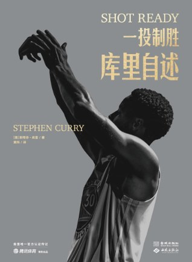

# 《一投制胜：库里自述》（Shot Ready）—— 斯蒂芬·库里 🏀

史上最伟大的射手，当年是个没人看得上的瘦小子——这本书想告诉你：伟大主要来自枯燥的苦练，而他学会了爱上它。

## 内容简介 📖

这本书讲的是库里高光时刻背后的习惯。他从来不是场上最高、最快、跳得最高的那个。上大学时还像个中学生，嘴上一撇细得像画上去的小胡子，篮球名校都不要他。于是他去了戴维森学院，比谁都练得狠。他的信条是："我们的练习不是练到投进为止，而是练到不可能投不进为止。"高中时，打了16个赛季NBA的父亲戴尔·库里帮他推倒重来改投篮姿势，从篮下近距离练起。那个夏天很煎熬，却让他学会了在看不到回报之前也要坚持。

全书的核心是"打地基"：基本功要反复打磨，否则整个职业生涯都在为缺陷打补丁。🎯 他和训练师布兰登·佩恩在比赛心率下练投篮，再练习把心率降下来——一个90秒的暂停，他就能让心率回到静息水平。练完后躺在地板上，肚子上压个沙袋练呼吸。在他看来，恢复也是一门要练的功夫。⏱️

然后是挫折：职业生涯早期两次脚踝手术，外界一度说他是"玻璃人"，成不了球星。他借康复期重塑了发力和动作模式，后来这副身体带他拿下四座总冠军，还成为NBA史上首位全票MVP。🏆 书里也谈领导力：科尔教练的谦逊、让他和克莱·汤普森重新定义"好球"的信任，以及杜兰特加盟时他的坦然。贯穿始终的是信仰和快乐："在我是篮球运动员之前，我是丈夫和父亲。在所有这些之前，我是一个信徒。"

## 我的评价 💭

10分满分。不懂篮球、不信教也没关系，这本书讲的是设定目标、努力、谦逊，以及在工作中找到快乐。

作为一个跑马拉松的人，训练那几章我特别有共鸣。用比赛心率去练，练快速恢复，还有那句"练习时越苦，比赛和生活就越轻松"，一句话说透了马拉松训练。🏃 他坦言每场比赛前依然紧张，季前赛也好，总决赛抢七也好，都一样。紧张挡不住，但来了可以控制。仪式感也帮了他：先戴左脚护踝再戴右脚，先穿左鞋再穿右鞋，每年选一首新歌，在去球馆路上的最后三分钟播放。

作为教数据课的老师，我最喜欢的一点是：只跟自己比。他每次训练结束都投100个三分，当作自己每天的数据。"感觉很重要，但数据是可以衡量的。"📊 还有一句想送给学生：社交媒体上你看到的只是成果，不是过程。

这本书很"干净"，库里很少露出不堪的一面，读起来更像一位教练在讲课，而不是一份忏悔。和泰森的《永不后退》放在一起读，是两条截然相反的登顶之路。不过科比说得对：他俩一样不惜一切想赢，只是库里笑着赢。😄

## 摘录 ✍️

> "我们的练习不是练到投进为止，而是练到不可能投不进为止。"

> "你最不舒服的时刻，往往是人生的转折点。那种不适感，正说明你在改变。"

> "别在批评面前退缩。批评得对，就记在心里；批评得不对，就用实力证明。"

📚 我在书中的全部划线摘录：[《一投制胜》笔记](/notes/shot-ready)
