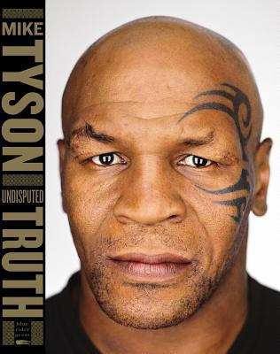

# Undisputed Truth — Mike Tyson (with Larry Sloman) 🥊

The baddest man on the planet turns out to be a terrified kid who never learned how to love himself — and this memoir is him figuring that out in public.

## Summary 📖

*Undisputed Truth* is Tyson's life in his own voice: profane, funny, self-lacerating, surprisingly philosophical. The spine of the book is Cus D'Amato, the old trainer who took in a poor kid from Brooklyn and rebuilt him from the mind outward. Cus's psychology is everywhere: the hero and the coward feel the same fear — only discipline separates them; your mind is not your friend, so you must control it. Cus sold Tyson not on money but on immortality, a name "known until the end of time." At 20 he became the youngest heavyweight champion ever — but Cus had died the year before, and the rest of the book is what happens to a weapon after the man who forged it is gone.

What happens is chaos. 💥 Tyson calls himself "a slave addicted to the chaos of celebrity" — women, cocaine, cars he never drove, houses he never lived in. He splits into two people: Mike, the husband and father, and "Tyson," the freak who generates money. In 1992 he was convicted of rape and served three years, yet he calls prison "a blessing in disguise" — the first time in his life he could be still. Then the long fall: the Buster Douglas upset, losing to Holyfield, bankruptcy after earning $300 million, faked drug tests, relapse after relapse. And slowly, the climb back 🌅: therapy, recovery programs, the realization that he used sex to buy intimacy because he was really searching for the mother's love he never got. His wife Kiki "dug me out of the gutter," and the death of his little daughter Exodus in 2009 becomes his reason to heal — one day at a time.

## My take 💭

I watched Tyson fight Lennox Lewis in 2002 as a kid — already the fallen Tyson, knocked out in eight rounds. This book filled in the story I'd only seen the middle of, and I loved it.

Fair warning: this may be the rawest memoir ever put on paper — the book clocks in at roughly 600 "fuck"s, 412 "shit"s, and 125 "nigga"s. 🤬 That's not sloppy editing; that's the voice, unfiltered, and it's exactly why the book feels true.

What hit hardest: this is a rock-bottom-and-back story. Cus taught that the only thing wrong with defeat is learning nothing from it, and Tyson lived it — he calls the Douglas loss his best fight, because he took his beating and rebounded. Broke, he felt rich for the first time: no watch, no phone, nobody chasing him. "This is rich, man." 🙌

But read it skeptically. Tyson maintains his innocence on the rape conviction — the court record stands. The parade of women is told honestly but with little reckoning; two marriages didn't survive the life he describes. His most convincing regret is the simplest: "I'm so happy to be with one woman." ❤️

He doesn't ask forgiveness — "I'm filthy and I'm wretched. But I want to make up for it now." Whether or not you believe him, the trying is the story.

## Quotes ✍️

> "The hero and the coward feel exactly the same but you have to have the discipline to do what a hero does."

> "It doesn't matter if you're losing; it's what you do after you lose."

> "Life is not about accumulation, life is about loss."

📚 My full highlights from the book: [Undisputed Truth notes](/notes/undisputed-truth)
