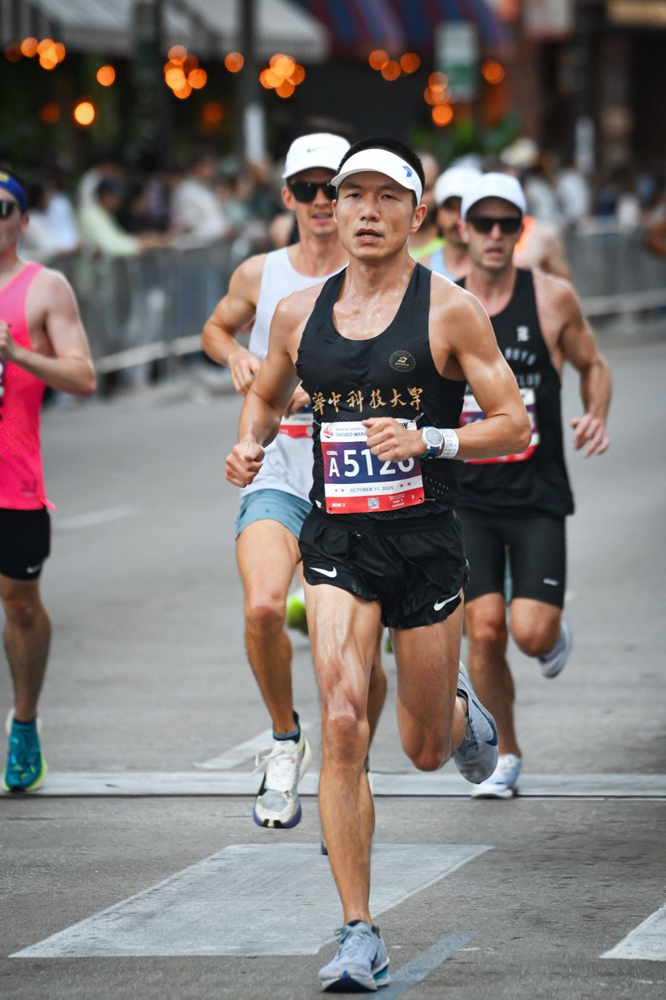
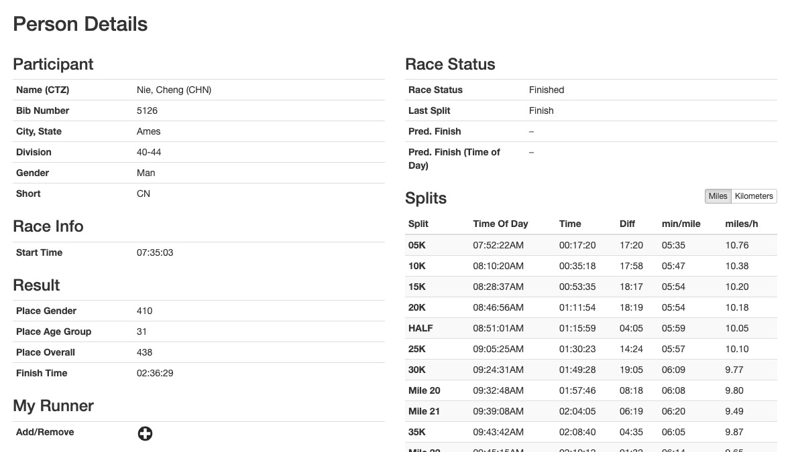
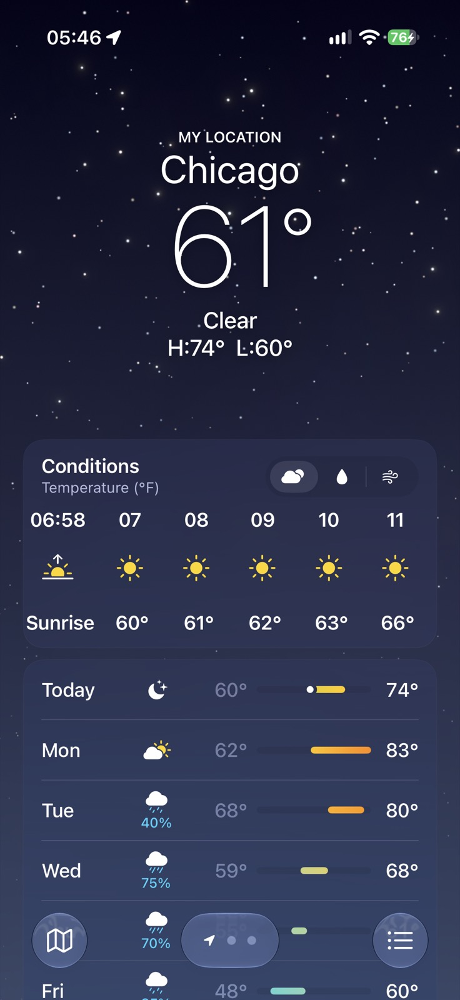
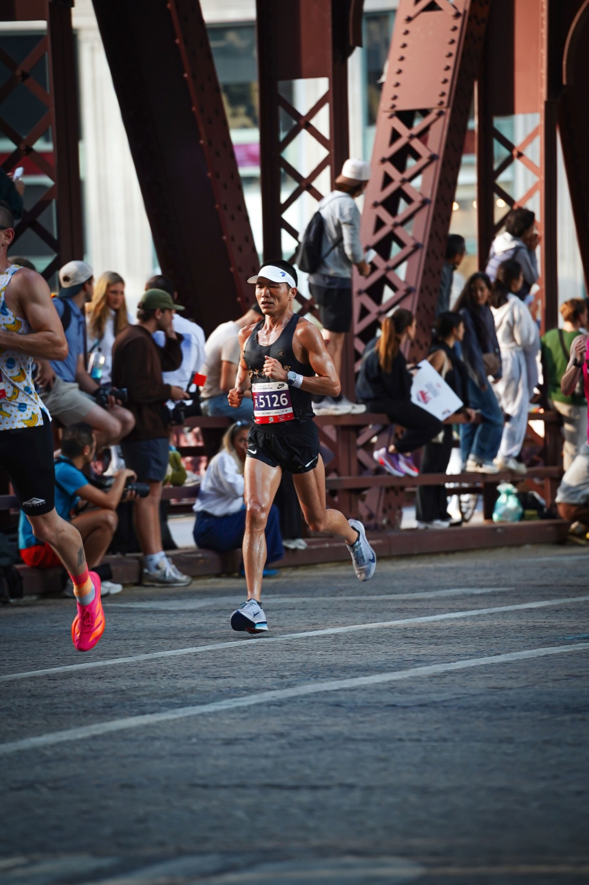
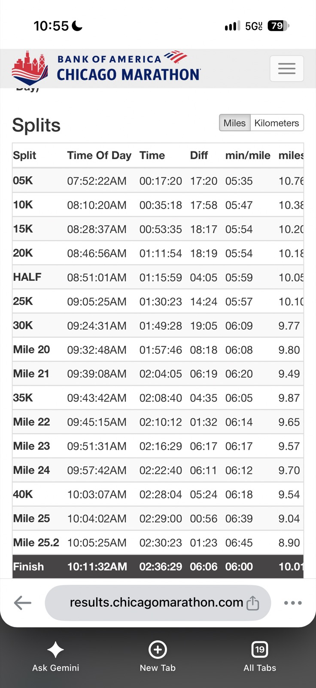
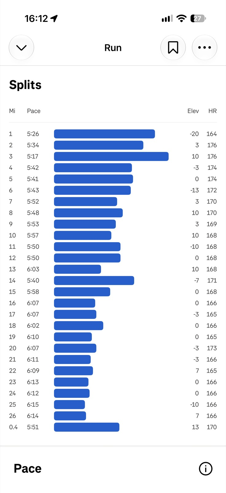
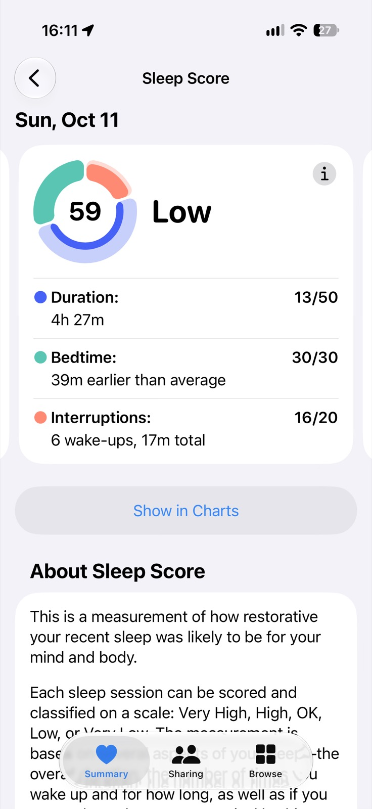
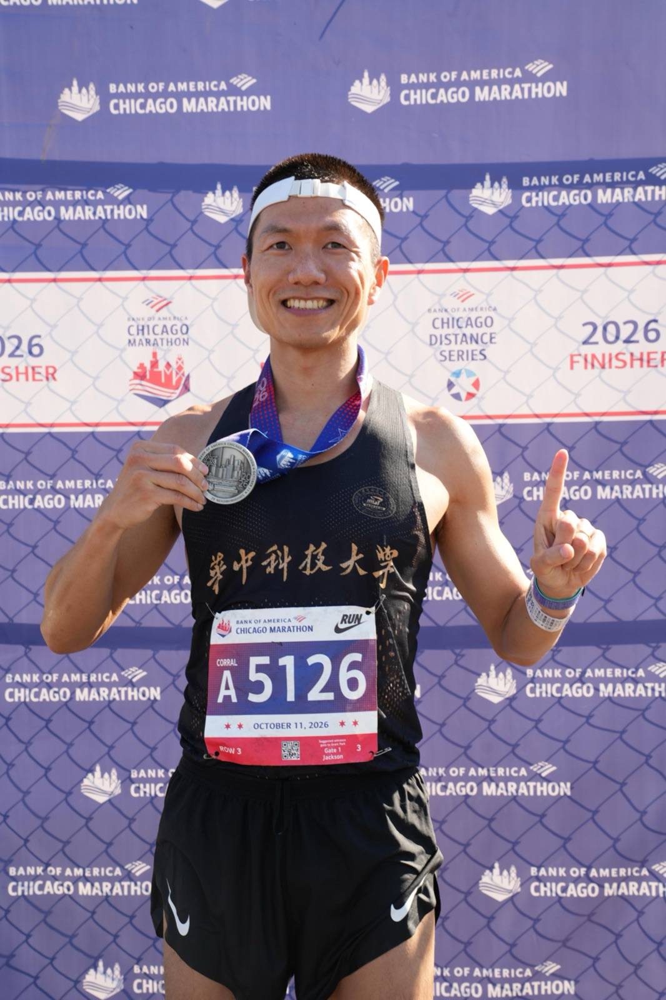

# Chicago Marathon 2026 🏅

On October 11, 2026, I ran the Chicago Marathon for the third time. I finished in **2:36:29—a new personal record (PR)**, 1:39 faster than my 2:38:08 at the Xiamen Marathon in January 2025, and 4:22 faster than Chicago last year. Here are my reflections on what went well, what I learned, and what I will change for the next one.

## What Went Well ✅

### Race Results ⏱️

I placed 438th overall, 410th among men, and 31st in my age group (40–44). Among all Chinese runners, I ranked #4, just 2 seconds behind 3rd place.

Top 10 Chinese runners:

| CHN Rank | Name | Overall | Division | Half | Finish |
|---|---|---|---|---|---|
| 1 | Zhang, Zhuoming | 154 | 30-34 | 01:13:19 | 02:27:44 |
| 2 | Li, Shirong | 271 | 25-29 | 01:14:47 | 02:32:17 |
| 3 | Zhang, Mengyuxin | 437 | 25-29 | 01:18:17 | 02:36:27 |
| **4** | **Nie, Cheng** | **438** | **40-44** | **01:15:59** | **02:36:29** |
| 5 | Jiang, Yu Chen | 668 | 35-39 | 01:17:58 | 02:40:03 |
| 6 | Ni, Yusheng | 688 | 55-59 | 01:19:26 | 02:40:24 |
| 7 | Jin, Jing | 770 | 40-44 | 01:20:58 | 02:41:37 |
| 8 | Situ, Kun | 1213 | 30-34 | 01:23:34 | 02:46:35 |
| 9 | Liu, Yanjun | 1237 | 50-54 | — | 02:46:46 |
| 10 | Yang, Yong | 1312 | 40-44 | 01:19:57 | 02:47:19 |

See the full [top 100 Chinese runners (CSV)](/files/chicago-marathon-2026-chn-top100.csv).

### Last Year's Lessons Paid Off 📒

Last year I wrote down what to fix, and this year I actually fixed it:

- **Breakfast:** No fatty croissant. I ate 3 pieces of plain bread instead.
- **Sunglasses:** I left them at the hotel. It was sunny again, and again I didn't need them—the buildings block most of the sun.
- **No deep-tissue work before the race:** On Saturday, my right foot felt a bit tense after a chilly electric-scooter ride back to the hotel. Instead of a massage gun, I gently rolled my foot and calf with a massage ball and foam roller. No pain at all during the race.

Writing race notes only helps if I read them before the next race. ✍️

### Nutrition Strategy 🥤⚡

Fueling worked great again. I forgot to drink my Maurten 320 Drink Mix on Saturday, so I drank 2 of them starting at 4 AM (my wave started at 7:35 AM). After the 3 pieces of bread, I sipped homemade Gatorade. I also took all my daily vitamins except fish oil.

Before the race:

- 6:00 AM: 1 Maurten Gel 160
- 6:30 AM: 1 Maurten Gel 100
- 7:20–7:30 AM: 3 Maurten gels (Gel 100, Gel 100 CAF, Gel 100)

I started the race carrying 1 caffeinated gel and 2 regular gels. During the race:

- Mile 3: 1 gel
- Mile 6: 1 caffeinated gel
- Mile 9: 1 gel
- Mile 12.4: 1 caffeinated gel (first Maurten station; picked up 1 extra)
- Mile 15: 1 gel (the one from Mile 12.4)
- Mile 18.1: 1 caffeinated gel (second and last Maurten station; picked up 2 extras)
- Mile 21: 1 gel
- Mile 24: 1 gel

For electrolytes, I took 7 SaltStick capsules: 1 with breakfast and 6 during the race, about every 5 miles. No cramping! 💪

### Race Day Logistics 🧢🧊

- **Weather:** About 60–63°F (16–17°C) during the race and clear. Sunny, but manageable.
- **Clothing:** I tossed my long-sleeve throwaway shirt before the start and my gloves right after the gun because it was already warm. Sunscreen meant I didn't worry about sunburn.
- **Corral position:** I squeezed into about the third row of Corral A and stretched there. After the pros left at 7:30 AM, they let us move up, and I got to the very front.
- **Staying light:** I made a last bathroom stop on my way to the corral, about 15 minutes before the start, so I felt light at the gun.
- **Sleep:** No jet lag this time.
- **Weight:** 130.2 lb two days before the race.

### Form Cues That Worked 🧠

I kept giving myself a few simple reminders:

- **Arms:** Work the arms, especially the right one. I touched my right chest with the back of my right hand to keep my upper body balanced.
- **Stride:** Take big steps.
- **Breathing:** Breathe in through the nose when I can. I played a counting game: 4 breaths in through the nose (counting 1-2-3-4), then 4 breaths in through the mouth (counting 5-6-7-8), always breathing out through the mouth. In the last 2 miles, I switched to 2 nose breaths and 6 mouth breaths.

The counting kept my mind busy when it wanted to tell me to slow down.

## What I Learned 💡

### I Started Too Fast 🏃‍♂️💨

Looking at the splits, the story is clear. My first 5K was 17:20 (5:35/mile, 3:28/km), and Strava shows 5:26, 5:34, and **5:17** for my first three miles, with my heart rate already at 176 bpm by Mile 2. I went through halfway in 1:15:59, but the second half took 1:20:30—a 4.5-minute positive split. From Mile 16 on, every mile was 6:02–6:15.

Last year, I noticed the same pattern: I thought I was running conservatively, but my heart rate said otherwise. Two Chicagos in a row, the early miles felt easy, and I paid for them later. A more even first 10K could easily be worth a minute at the end.

### My Toes Need More Room 👟

From Mile 13, I felt pain in my left second toe. It is going to turn black. This wasn't a one-off:

- In the Adidas Evo Pro 4 (size 10), toe pain started around Mile 18.
- In my Nike (size 10) at the Sydney Marathon about six weeks earlier, I felt it a bit, but not as badly as this time.

I think the warmer weather in Chicago made my feet swell more than in Sydney. Lesson: **size 10.5 from now on.** The first-place Chinese finisher also recommended the Puma Fast-R3, so it's on my list to try.

### Sleep Is Part of Training 😴

I spent an hour (8:45–9:45 PM) editing and posting a video the night before the race. That cut an hour of sleep. I only got 4 hours 27 minutes, with 6 wake-ups. My sleep score was still higher than before Sydney, which I used to encourage myself—but I shouldn't need to.

I'm allergic to feathers, but I forgot to request feather-free bedding. Aloft (Marriott) used feather blankets and pillows. I wrapped the pillow in a towel, but I still scratched my face a lot during the night, and the next day I could see small feather particles on the pillow.

## What I Can Improve 🔧

### Before the Race 🗓️

- **Shoes:** Switch to size 10.5. 👟
- **Pacing:** Run the first 10K closer to goal pace instead of banking time. Let the heart rate, not the excitement, set the pace for the first 3 miles.
- **Bib pickup:** Leave much more time. I was 4 minutes from missing the bib pickup cutoff. I underestimated downtown Chicago traffic around 6 PM: calling, waiting, switching, and waiting again for Ubers took almost an hour to cover 4 miles from the hotel to the Expo. 😰
- **Screens off:** No video editing or posting the night before. Content can wait; sleep can't.
- **Hotel:** Ask for a feather-free room. Stay closer to the start—from Aloft, it took us 35 minutes (6:30–7:05 AM) to walk to bag check.
- **Recovery:** There was no bathtub this time, so I took a longer hot shower to relax my muscles instead. Next time I'll check for a bathtub when booking.

### Race-Day Gear 🎒

- **SaltStick packs:** My self-made packs were hard to tear open while running. Next time, I'll try a tiny Ziploc bag or tape the capsules to a gel.
- **Finish bag:** Pack a towel and toe spacers. This time I had to wipe myself with my long pants.

### On the Course 👀

Around Mile 12, I stepped on a stone with my right heel. Luckily, I didn't twist my ankle. Chicago's roads are uneven in many places, so I need to keep an eye on the surface, especially when running in a crowd.

## Road to Sub-2:30 🎯

I believe a 10.5 shoe and slightly cooler weather would help me get close to 2:30, but closing the last 6 minutes will take more than that. My endurance base is there, so the missing piece is probably anaerobic ability. The plan:

- Keep my mileage at about 10 miles per day (70 miles per week, 300 miles per month).
- Add regular speed work to build anaerobic capacity.
- Practice even pacing in long runs so that the race plan feels natural on race day.

## Final Thoughts 🏁

Chicago 2025 taught me to listen to my body. Chicago 2026 taught me that the notes I write after a race are only as good as the changes I make before the next one. I fixed the breakfast, the sunglasses, and the massage gun, and I got a PR. Now I have a new list: bigger shoes, a calmer start, an earlier bedtime, and more speed work. See you next time, Chicago. 🧪

