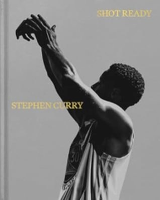

# Shot Ready — Stephen Curry 🏀

The greatest shooter of all time was the skinny kid nobody wanted to recruit — and this book is his case that greatness is mostly boring work you learn to love.

## Summary 📖

*Shot Ready* is Curry's story told through the habits behind the highlights. He was never the tallest, the fastest, or the highest jumper. In college he "looked like a middle-schooler" with a mustache so thin it seemed drawn on, and the big programs passed on him. So he went to Davidson and outworked everyone. His motto: "We practice not until I get the shot right, but until I can't get it wrong." As a teenager, his dad Dell, a 16-year NBA shooter, rebuilt his shot from scratch, starting close to the rim. That frustrating summer taught him to stay committed long before the work paid him back.

The core idea is grounding: master and remaster the fundamentals, or you'll spend your career compensating for flaws. 🎯 With trainer Brandon Payne, he shoots at game-level heart rate, then practices bringing it back down. He can get to a resting heart rate in a single 90-second timeout. After drills, he lies on the court with a sandbag on his belly to train his breathing. Recovery, he says, is a skill you have to practice too. ⏱️

Then the setbacks: two ankle surgeries early on and a label as too fragile to be a star. He used the rehab to rebuild how he moves, and that body carried him to four championships and the first unanimous MVP in NBA history. 🏆 Along the way he writes about leadership: Steve Kerr's humility, the trust that let him and Klay redefine a "good shot," and welcoming Kevin Durant without feeling threatened. Under all of it are faith and joy: "Before I am a basketball player, I am a husband and a father. And before all those things, I am a believer."

## My take 💭

10/10. You don't need to love basketball or share his faith to get a lot out of it. It's a book about setting goals, working hard, staying humble, and finding joy in the work.

As a marathon runner, I felt the training chapters. Practice at race-level heart rate, learn to recover fast, and "Making life harder in practice makes things easier in life." That's marathon training in one sentence. 🏃 He still gets nerves before every game, preseason or Game 7. He can't stop them; he controls them once they arrive. Rituals help: left ankle brace before right, left shoe before right, and a new song every year for the last three minutes of the drive to the arena.

As someone who teaches data courses, my favorite idea is to compare yourself to yourself. He shoots 100 threes at the end of every workout as his own daily stat. "Feelings are important, but data is something you can measure." 📊 And one line for my students: social media shows you "a product, not a process."

The book is polished. Curry rarely shows his ugly side, so it reads more like a coach than a confession. Read it next to Tyson's *Undisputed Truth* and you get two opposite roads to the top. But Kobe got it right: they shared the same willingness to do whatever it takes to win. Curry just does it with a smile. 😄

## Quotes ✍️

> "We practice not until I get the shot right, but until I can't get it wrong."

> "The times when you're most uncomfortable are the inflection points in your life. The discomfort is how you know you are changing."

> "Don't cower from the criticism. If it's right, take it to heart. If it's wrong, prove it."

📚 My full highlights from the book: [Shot Ready notes](/notes/shot-ready)
